# Awesome-Unified-SaaS-Data-Protection-Platform

  

  <b>A curated catalog of premier Unified SaaS Data Protection Platforms, Cloud Backup Solutions, Cyber Resilience Suites, and Open-Source Disaster Recovery Engines.</b>

---

## 📌 Table of Contents 📑

- [🌟 Introduction & Vision](#-introduction--vision-)
- [📈 Sector Overview & Market Dynamics](#-sector-overview--market-dynamics-)
- [🟦 Commercial SaaS / Hosted Platforms](#-commercial-saas--hosted-platforms-)
  - [🏢 Enterprise SaaS Matrix (Ranked by Scale / Valuation)](#-enterprise-saas-matrix-ranked-by-scale--valuation-)
  - [🔍 Detailed SaaS Platform Profiles](#-detailed-saas-platform-profiles-)
- [🟩 Open-Source Software](#-open-source-software-)
  - [⭐ Open-Source Leaderboard (Sorted by GitHub_Stars)](#-open-source-leaderboard-sorted-by-github-stars-)
  - [🛠️ Deep-Dive Open-Source Tools](#-deep-dive-open-source-tools-)
- [⚖️ Feature Comparison at a Glance](#-feature-comparison-at-a-glance-)
- [🤝 Contributing](#-contributing-)
- [💖 Support & Sponsorship](#-support--sponsorship-)
- [⭐ Star History](#-star-history-)
- [📄 License](#-license-)

---

## 🌟 Introduction & Vision 💡

As enterprises aggressively migrate business-critical workloads into multicloud environments and Software-as-a-Service applications (such as Microsoft 365, Google Workspace, Salesforce, Snowflake, and AWS/GCP native datastores), the **Cloud Shared Responsibility Model** mandates that organizations retain sole ownership and governance of their data. 

**Unified SaaS Data Protection** bridges this imperative by delivering zero-trust, air-gapped, immutable backups with AI-driven cyber resilience, granular point-in-time recovery (PITR), and instant ransomware containment across fragmented SaaS and IaaS landscapes.

---

## 📈 Sector Overview & Market Dynamics 📊

> **Market Sizing:** The global SaaS Data Protection and Cloud Backup market is estimated at **$4.9B – $6.8B in 2024–2025** and projected to expand at a Compound Annual Growth Rate (**CAGR of 15.2% – 16.7%**), crossing **$14B+ by 2032** within the broader **$26B – $31B Data Protection-as-a-Service (DPaaS)** industry.
> 
> **Market Concentration & Structure:** The sector is **moderately concentrated among a core tier of multi-billion-dollar enterprise giants** (Dell, Veeam, Rubrik, Commvault, and Cohesity) who dominate enterprise-wide hybrid infrastructure contracts; however, it remains **highly fragmented across the SaaS and mid-market edges**, where specialized BaaS niche vendors, MSP-focused platforms (Datto, Acronis), and innovative zero-trust open-source engines compete vigorously for cloud-native workloads.

---

## 🟦 Commercial SaaS / Hosted Platforms ☁️

### 🏢 Enterprise SaaS Matrix (Ranked by Scale / Valuation) 📊

Below is the comparative breakdown of commercial Unified SaaS Data Protection platforms, ranked in **descending order by company scale** (Market Capitalization, Private Valuation, or Annual Revenue). Every pricing figure represents verified entry-level tiers, and every free tier column details perpetual allowances or exact trial durations and terms.

| Company / Platform 🏷️ | Scale / Valuation 💰 | Starting Tier Pricing 🏷️ | Free Tier Limits / Trial Period ⏱️ | Key SaaS & Workload Focus 🎯 | Architecture Type 🏗️ |
|:---|:---|:---|:---|:---|:---|
| [**Dell PowerProtect Data Manager**](https://www.dell.com/en-us/dt/data-protection/powerprotect-data-manager.htm) | **~$95B – $100B+** (Revenue) / **~$220B+** Market Cap | **$4,495.00 / CPU socket** base list (or FETB-metered enterprise tier) | **90-Day Full Evaluation License** (Unlocks complete software suite & array features) | VMware, Hyper-V, Kubernetes, Oracle, Exchange, Dell Storage Arrays | Software-Defined / Appliance |
| [**Veeam Data Platform**](https://www.veeam.com/products/data-platform.html) | **$15.0B Valuation** (~$1.7B+ ARR) | **$155.00 / workload / year** (Foundation 10-pack bundle at ~$1,550/yr; Cloud Vault at $14.00/TB/mo) | **Free Forever Community Edition** (Full functionality capped permanently at **10 workloads**); **30-Day Free Trial** for Enterprise | Microsoft 365, Salesforce, AWS, Azure, GCP, VMware, Hyper-V | Hybrid SaaS & Self-Hosted |
| [**Rubrik Security Cloud**](https://www.rubrik.com/) | **~$11.0B – $14.0B** Market Cap (~$1.18B ARR) | **$130.00 / usable BETB / month** (Foundation tier; multi-year enterprise contract) | **30-Day Custom Enterprise POC** (Hands-on sandbox with dedicated solutions architect) | Microsoft 365, Jira, Salesforce, AWS, Azure, GCP, Sovereign RSC-P | Cloud SaaS & Sovereign Private |
| [**Datto SaaS Protection**](https://www.datto.com/products/saas-protection/) | **$6.2B** (Kaseya acquisition) | **$1.50 – $3.00 / user / month** (Base domain minimum starting at ~$15.00/mo via MSPs) | **No Direct Public Self-Serve Trial** (Provided on-demand via MSP partner demo programs) | Microsoft 365 (Exchange, Teams, OneDrive, SharePoint), Google Workspace | Fully Managed SaaS (MSP-first) |
| [**Commvault Cloud**](https://www.commvault.com/) | **~$6.5B – $7.0B** Market Cap (~$1.03B ARR) | **$1.70 / user / month** (Standard M365 tier, 5 GB pooled; Database/workloads from $58.50/TB/mo) | **30-Day Free Trial** (Full SaaS platform access across hybrid/SaaS workloads, no credit card required) | Microsoft 365, Salesforce, Dynamics 365, Endpoints, AWS, Azure, OCI | Fully Managed SaaS |
| [**Cohesity Data Cloud**](https://www.cohesity.com/) | **~$3.0B – $7.0B Valuation** (Combined with Veritas DP) | **$12.50 – $33.30 / TB / month** ($150 – $400/TB/yr BYOH software-only model) | **30-Day Free Trial** (Cohesity DataProtect as a Service trial via AWS/Azure Marketplace) | Microsoft 365, VMware, Kubernetes, NAS, Nutanix, AWS, Cohesity Gaia AI | Cloud SaaS & Hybrid Cluster |
| [**Acronis Cyber Protect**](https://www.acronis.com/) | **~$3.5B Valuation** (Majority backed by EQT) | **$7.08 / workstation / month** ($85.00/yr Standard Edition workstation license) | **30-Day Free Trial** (Full evaluation of Acronis Cyber Protect Cloud with integrated security) | Microsoft 365, Google Workspace, Physical Workstations, Virtual Machines | Hybrid Cloud / MSP Platform |
| [**Veritas Alta**](https://www.veritas.com/alta) | **~$3.0B+ Scale** (Historic enterprise data assets) | **$50.00 / user / month** (Alta SaaS Protection baseline module; or Azure meter consumption) | **30-Day Guided Proof-of-Concept** (Structured enterprise evaluation with cloud sandbox) | Microsoft 365, Slack, Box, Salesforce, Multicloud IaaS, Hybrid Storage | Cloud-Native & Enterprise Core |
| [**Druva Data Protection Platform**](https://www.druva.com/) | **~$2.0B+ Valuation** ($200M+ ARR) | **$8.00 / user / month** (Business Edition SaaS workloads; AWS storage at $0.023/GB/mo) | **30-Day Free Trial** (Instant self-service cloud onboarding, no credit card required) | Microsoft 365, Google Workspace, Salesforce, Azure Files, Endpoints, EC2 | 100% Serverless SaaS |
| [**Clumio Cloud Protect**](https://www.clumio.com/) | **~$250M Valuation** (Acquired by Commvault) | **$0.025 / GB / month** (Protected S3/DynamoDB volume metering via AWS Marketplace) | **14-Day Free Trial** (Self-service setup on AWS Marketplace with managed usage credit) | AWS (S3, DynamoDB, RDS, EC2), Google Cloud Storage, Apache Iceberg | Serverless Cloud-Native API |

---

### 🔍 Detailed SaaS Platform Profiles 📝

#### 🛡️ Dell PowerProtect Data Manager
- **Type:** Software-defined enterprise cyber resilience & multicloud backup
- **Key Capabilities:** Delivers Transparent Snapshots for VM image backups without external proxies, Dynamic NAS Protection (up to 3x faster backups), and native Kubernetes backup. Integrates directly with Dell PowerStore, PowerMax, and PowerProtect DD appliances.
- **Best Suited For:** Dell-centric enterprise environments seeking hardware-accelerated backup, storage deduplication, and self-service governance.

#### ⚡ Veeam Data Platform
- **Type:** Unified data resilience with AI-powered cyber security
- **Key Capabilities:** Veeam Data Platform v13 combines physical, virtual, and cloud workload protection. Features zero-trust RBAC, automated appliance patching, SAML SSO with MFA, native immutability by default, and Veeam Intelligence AI agents for automated threat forensics.
- **Best Suited For:** Mid-market to global enterprises desiring proven, rock-solid recovery across VMware, physical infrastructure, and Microsoft 365.

#### 🔒 Rubrik Security Cloud
- **Type:** Zero-trust data security with sovereign cloud & air-gapped deployment
- **Key Capabilities:** End-to-end data immutability, AI-driven Turbo Threat Hunting across backup snapshots, and automated cyber recovery simulation. Offers **RSC-P (Private)** edition for sovereign and air-gapped defense networks (FIPS 140-3, DoDIN APL, Common Criteria EAL2+).
- **Best Suited For:** Highly regulated industries, financial institutions, and government defense agencies mandating strict jurisdictional data sovereignty.

#### 💼 Datto SaaS Protection
- **Type:** Managed SaaS backup engine for MSPs protecting M365 & Google Workspace
- **Key Capabilities:** Automated 3x daily snapshots with unlimited cloud retention and zero hidden egress fees. Provides point-in-time granular recovery of emails, OneDrive files, SharePoint libraries, and Teams channels, alongside end-user self-service restore portals.
- **Best Suited For:** Managed Service Providers (MSPs) and small-to-midsize businesses needing set-and-forget cloud application protection.

#### ☁️ Commvault Cloud
- **Type:** Cyber resilience platform powered by metallic AI architecture
- **Key Capabilities:** Threat Scan correlator analyzing anomaly indicators, entropy analytics, and EDR feeds (CrowdStrike, Palo Alto Networks, Sentinel). Its signature **Synthetic Recovery** surgically isolates infected files and synthesizes clean recovery points in validated cleanroom environments.
- **Best Suited For:** Organizations demanding active ransomware containment, deep API integrations, and instant enterprise recovery orchestration.

#### 🌐 Cohesity Data Cloud
- **Type:** AI-driven cyber-resilient hybrid data platform
- **Key Capabilities:** Comprehensive protection for 1,000+ workload variants across cloud, on-premises, and SaaS. Leverages Google Threat Intelligence feeds for hash-based anomaly detection and integrates **Cohesity Gaia** to turn backup data into searchable AI knowledge bases.
- **Best Suited For:** Large organizations looking for unified data consolidation, cleanroom disaster simulations, and enterprise AI data activation.

#### 🛡️ Acronis Cyber Protect
- **Type:** Integrated cybersecurity, endpoint protection, and backup for MSPs
- **Key Capabilities:** Fuses anti-malware, anti-ransomware, EDR/XDR, vulnerability assessments, patch management, and automated disk imaging into a single multi-tenant console.
- **Best Suited For:** IT service providers seeking to replace sprawling multi-agent stacks with a single unified protection client.

#### 🏛️ Veritas Alta
- **Type:** Cloud-native multicloud data management and compliance suite
- **Key Capabilities:** Unified control plane (**Alta View**) with AI-powered telemetry managing on-premise and multi-cloud estates. Features non-disruptive disaster recovery rehearsals, automated tamper-proofing, and comprehensive legal hold/data compliance modules.
- **Best Suited For:** Global enterprises maintaining complex compliance mandates and hybrid mainframe-to-cloud footprints.

#### 🚀 Druva Data Protection Platform
- **Type:** 100% SaaS-based, cloud-native serverless data protection
- **Key Capabilities:** Fully managed, air-gapped architecture completely outside the client's AWS/Azure tenant. Eliminates backup proxies, compute nodes, and manual patches, featuring zero-egress charges for restore operations.
- **Best Suited For:** Modern organizations desiring an autonomous, zero-maintenance SaaS backup service across Microsoft 365, Salesforce, and cloud VMs.

#### ⚡ Clumio Cloud Protect
- **Type:** API-first, high-throughput serverless backup for AWS & Google Cloud
- **Key Capabilities:** Rapid point-in-time recovery down to the exact second for petabyte-scale Amazon S3 buckets, DynamoDB tables, RDS databases, and Google Cloud Storage. Full REST API and Terraform providers facilitate seamless DevSecOps integration.
- **Best Suited For:** Cloud-native engineering teams needing scalable, programmatic snapshot isolation and near-instant restore speeds.

---

## 🟩 Open-Source Software 🔓

Self-hosted, community-driven backup software and data protection solutions. While direct SaaS application connectors (e.g. M365, Salesforce APIs) are emerging, these battle-tested open-source engines provide cryptographic immutability, zero-knowledge encryption, and local-to-cloud deduplication.

### ⭐ Open-Source Leaderboard (Sorted by GitHub_Stars) 🏆

The leaderboard below is strictly sorted in **descending order by GitHub Stars_Count**. Each badge is rendered in `style=social` and links directly to the project's stargazers page.

| Project Name 📦 | GitHub_Stars ⭐ | Primary Stack 💻 | License 📜 | SaaS / Cloud Workload Capabilities ☁️ | Best For 💡 |
|:---|:---|:---|:---|:---|:---|
| [**Rclone**](https://github.com/rclone/rclone) |  | Go | MIT | 70+ Cloud & SaaS Storage Backends (Google Drive, OneDrive, S3, Dropbox) | Universal cloud sync & multi-backend data piping |
| [**Restic**](https://github.com/restic/restic) |  | Go | BSD-2-Clause | Cloud Storage targets (S3, B2, Azure, GCS, SFTP) | Scriptable, rock-solid zero-knowledge CLI backup |
| [**Duplicati**](https://github.com/duplicati/duplicati) |  | C# / .NET | MIT / LGPL | Web UI + 20+ Cloud destinations (Google Drive, OneDrive, S3) | Desktop & home-server automated cloud backups |
| [**Kopia**](https://github.com/kopia/kopia) |  | Go | Apache-2.0 | S3, Azure Blob, GCS, Backblaze B2, WebDAV, SFTP | Fast snapshotting with desktop/web UI & policies |
| [**BorgBackup**](https://github.com/borgbackup/borg) |  | Python / C | BSD-3-Clause | Authenticated SSH, Cloud storage via rclone/SSHFS | Legendary chunk-level deduplication for Linux servers |
| [**Velero**](https://github.com/velero-io/velero) |  | Go | Apache-2.0 | Kubernetes Cluster State, Persistent Volumes, Cloud Provider Snapshots | De-facto Kubernetes backup, migration & disaster recovery |
| [**Backrest**](https://github.com/garethgeorge/backrest) |  | Go / TypeScript | GPL-3.0 | Modern WebUI orchestrator for Restic with cloud repository sync | Visual multi-machine Restic management & monitoring |
| [**Bup**](https://github.com/bup/bup) |  | Python / C | LGPL-2.0 | Git packfile format backup for massive datasets | Petabyte-scale incremental disk image & file backups |
| [**Borgmatic**](https://github.com/borgmatic-collective/borgmatic) |  | Python | GPL-3.0 | Declarative PostgreSQL, MySQL, SQLite, and filesystem hooks | Automated declarative BorgBackup pipelines & monitoring |
| [**Plakar**](https://github.com/PlakarKorp/plakar) |  | Go | Apache-2.0 | Direct SaaS Connectors (Notion), S3, SFTP, MySQL, PostgreSQL | Unified open backup with single-pass compress-dedup-encrypt |
| [**Autorestic**](https://github.com/cupcakearmy/autorestic) |  | Go | Apache-2.0 | Multi-backend Restic orchestration via YAML configs | Simple declarative CLI automation for Restic repositories |
| [**Bareos**](https://github.com/bareos/bareos) |  | C++ / Python | AGPL-3.0 | Enterprise clients, Cloud storage backends, Tape, Ceph | Enterprise datacenter backup (Bacula fork) with WebUI |

---

### 🛠️ Deep-Dive Open-Source Tools 🔍

#### 🌐 [Rclone](https://github.com/rclone/rclone)
- **Tech Stack:** Go | **License:** MIT
- **Overview:** Known as the *"Swiss army knife of cloud storage"*, Rclone syncs files and directories to and from over 70 cloud storage providers including Google Drive, Microsoft OneDrive, Nextcloud, Backblaze B2, and Amazon S3. Features end-to-end client encryption (crypt), bandwidth limits, hash checksum verification, and FUSE mount support.
- **Why it stands out:** Unlocks direct integration between arbitrary cloud and SaaS object stores without vendor friction.

#### 🛡️ [Restic](https://github.com/restic/restic)
- **Tech Stack:** Go | **License:** BSD-2-Clause
- **Overview:** A secure backup program that uses cryptography (AES-256 in counter mode, Poly1305 MAC) to guarantee data confidentiality and integrity. Every snapshot functions as a full backup thanks to content-defined chunking (CDC) deduplication.
- **Why it stands out:** Extreme reliability, completely standalone binary, and broad cloud storage backend support.

#### 🖥️ [Duplicati](https://github.com/duplicati/duplicati)
- **Tech Stack:** C# / .NET | **License:** MIT / LGPL
- **Overview:** Provides a beginner-friendly web dashboard for configuring scheduled, incremental, encrypted backups directly to standard cloud storage targets.
- **Caveat:** Community threads caution against database fragility on large sets (>1 TB); best paired with desktop usage and regular restore validation drills.

#### ⚡ [Kopia](https://github.com/kopia/kopia)
- **Tech Stack:** Go | **License:** Apache-2.0
- **Overview:** Fast, deduplicated, zero-knowledge backup tool with both CLI and first-class desktop GUI (**KopiaUI**). Supports compression algorithms (zstd, s2), custom snapshot retention policies, and enterprise multi-user repository server setups.
- **Why it stands out:** Native visual management with robust error-correction algorithms and high-speed multi-threaded uploads.

#### 🗄️ [BorgBackup](https://github.com/borgbackup/borg)
- **Tech Stack:** Python / C | **License:** BSD-3-Clause
- **Overview:** Deduplicating archiver famous for efficiency. Uses chunk-level deduplication based on content-defined chunking, authenticated encryption, and local cache architectures.
- **Why it stands out:** Incomparable storage savings for multi-system Linux backups and long-term archive retention.

#### ☸️ [Velero](https://github.com/velero-io/velero)
- **Tech Stack:** Go | **License:** Apache-2.0
- **Overview:** The industry standard for Kubernetes disaster recovery, cluster migration, and scheduled state backups. Captures cluster resources (deployments, CRDs, secrets) and triggers CSI storage volume snapshots.
- **Why it stands out:** The foundational open-source tool for cloud-native SaaS infrastructure protection on EKS, GKE, and AKS.

#### 🎛️ [Backrest](https://github.com/garethgeorge/backrest)
- **Tech Stack:** Go / TypeScript | **License:** GPL-3.0
- **Overview:** A modern web management UI and orchestration daemon built on top of the Restic engine. Adds automated cron scheduling, multi-repository orchestration, Slack/Discord notification webhooks, and snapshot browsing.
- **Why it stands out:** Delivers an enterprise-like operational dashboard to scriptable Restic environments.

#### 📦 [Bup](https://github.com/bup/bup)
- **Tech Stack:** Python / C | **License:** LGPL-2.0
- **Overview:** Highly efficient backup tool based on the Git packfile format. Able to split huge virtual disk images into tiny blocks and reconstruct snapshots instantly.
- **Why it stands out:** Proven durability for virtual machine raw image files and multi-terabyte data stores.

#### ⚙️ [Borgmatic](https://github.com/borgmatic-collective/borgmatic)
- **Tech Stack:** Python | **License:** GPL-3.0
- **Overview:** Declarative wrapper for BorgBackup that automates database dumps (PostgreSQL, MySQL, MongoDB), snapshot generation, encryption key management, and monitoring health checks.
- **Why it stands out:** Transforms raw Borg CLI operations into reproducible, GitOps-ready YAML pipelines.

#### 🚀 [Plakar](https://github.com/PlakarKorp/plakar)
- **Tech Stack:** Go | **License:** Apache-2.0
- **Overview:** A modern unified backup platform built around the **Kloset engine**, resolving the traditional dilemma where encryption breaks deduplication by executing chunking, compression, deduplication, and zero-knowledge encryption in a single pass. Features native connectors for SaaS sources (Notion), relational databases, and S3 buckets.
- **Why it stands out:** One of the only open-source initiatives actively creating native application connectors for SaaS knowledge bases.

#### 🤖 [Autorestic](https://github.com/cupcakearmy/autorestic)
- **Tech Stack:** Go | **License:** Apache-2.0
- **Overview:** High-level orchestrator for Restic repositories using declarative configuration files. Handles multi-location backups, health verification checks, and automated cleanup policies.
- **Why it stands out:** Simplifies complex multi-location Restic setups into a single configuration file.

#### 🏢 [Bareos](https://github.com/bareos/bareos)
- **Tech Stack:** C++ / Python | **License:** AGPL-3.0
- **Overview:** An enterprise-scale, open-source client/server backup solution fork of Bacula. Manages automated backup, recovery, and verification across heterogeneous Linux, Windows, macOS, tape autoloaders, and Ceph storage clusters.
- **Why it stands out:** A complete self-hosted alternative for traditional enterprise datacenter tape and disk storage networks.

---

## ⚖️ Feature Comparison at a Glance 📊

| Solution 🏷️ | Core Focus 🎯 | Native SaaS Workloads (M365 / SFDC) ☁️ | Kubernetes / Container Aware ☸️ | Self-Hosted Option 🏠 | Encryption Model 🔐 | Primary License 📜 |
|:---|:---|:---:|:---:|:---:|:---|:---|
| **Dell PPDM** | Multicloud & Storage Array | ⚠️ (via apps) | ✅ Native | ✅ Primary | Hardware / Enterprise Key Mgmt | Commercial |
| **Veeam** | Hybrid Resilience & M365 | ✅ Extensive | ✅ (Kasten K10) | ✅ Supported | AES-256 + Cloud Immutability | Commercial |
| **Rubrik** | Zero-Trust Data Security | ✅ Broad | ✅ Native | ✅ (RSC-P Sovereign) | End-to-End Immutability | Commercial |
| **Datto** | MSP Cloud Application Backup | ✅ Dedicated | ❌ | ❌ Pure SaaS | Encrypted at rest & transit | Commercial |
| **Commvault Cloud** | Threat Scanning & Recovery | ✅ Broad | ✅ Native | ✅ Supported | Multi-layered AES-256 | Commercial |
| **Cohesity** | Cyber Resilience & AI Data | ✅ Broad | ✅ Native | ✅ Appliance / Cloud | Zero-Trust DataLock | Commercial |
| **Acronis** | Integrated Security & Backup | ✅ Dedicated | ⚠️ Basic | ✅ MSP Cloud | AI-monitored AES-256 | Commercial |
| **Veritas Alta** | Governance & Cloud Resilience | ✅ Broad | ✅ Native | ✅ Hybrid Core | Zero-Trust + Tamper-Proof | Commercial |
| **Druva** | Autonomous Serverless SaaS | ✅ Deep (M365/SFDC) | ⚠️ (via AWS) | ❌ 100% Cloud | Air-Gapped Cloud Vault | Commercial |
| **Clumio** | Serverless AWS / GCS | ⚠️ Cloud Object/DB | ⚠️ S3-based | ❌ 100% Cloud | Air-Gapped S3 Immutability | Commercial |
| **Rclone** | Cloud-to-Cloud Data Pipe | ⚠️ Storage Sync | ❌ | ✅ CLI / Daemon | Optional client-side crypt | MIT |
| **Restic** | Snapshot File Engine | ❌ (Target only) | ❌ | ✅ Pure Local/Cloud | Poly1305 + AES-256 | BSD-2-Clause |
| **Duplicati** | Web-Managed Cloud Backup | ⚠️ Basic cloud targets | ❌ | ✅ Self-Hosted | AES-256 / GPG | MIT / LGPL |
| **Kopia** | Deduplicated Fast Snapshotter | ❌ (Target only) | ❌ | ✅ GUI / Server | Scrypt + AES-256-GCM | Apache-2.0 |
| **BorgBackup** | Enterprise Deduplication | ❌ | ❌ | ✅ Self-Hosted | AES-256 + HMAC-SHA256 | BSD-3-Clause |
| **Velero** | Kubernetes State & Disks | ❌ (K8s focus) | ✅ De-Facto Standard | ✅ Self-Hosted In-Cluster | Provider Native Storage KMS | Apache-2.0 |
| **Backrest** | Restic WebUI & Automation | ❌ (Target only) | ❌ | ✅ Self-Hosted | Inherits Restic Encryption | GPL-3.0 |
| **Plakar** | Unified Engine with Connectors| ✅ Connectors (Notion/DB) | ⚠️ Emerging | ✅ Self-Hosted | Zero-Knowledge Single-Pass | Apache-2.0 |

---

## 🤝 Contributing 🚀

Contributions are enthusiastically welcomed! Help keep this curated resource comprehensive, accurate, and up to date.

1. **Fork** this repository.
2. **Create** a descriptive branch (`git checkout -b feature/add-new-backup-engine`).
3. **Add** the platform or tool with verified information:
   - Official URL & GitHub repository link
   - Precise pricing model or license details
   - Architectural strengths and workload specialties
4. **Submit** a pull request with a concise overview of changes.

---

## 💖 Support & Sponsorship ☕

If this curated repository saved you time, helped architect your disaster recovery strategy, or introduced you to new backup tools, please consider supporting the project!

- ⭐ **Star this repository** to improve visibility for the cloud security and backup community.
- 🍴 **Fork and contribute** new open-source backup engines or platform updates.
- 📢 **Share with your team** and network on LinkedIn, X/Twitter, or Reddit.
- ☕ **Buy a coffee & sponsor ongoing maintenance:**  
    
  Visit the [GitHub Sponsors Dashboard](https://github.com/sponsors/ishandutta2007) to help support continuous curation, benchmarks, and community guides. Thank you for your support! 🙌

---

##  Star History

---

## 📄 License ⚖️

This collection is distributed under the [Creative Commons Zero v1.0 Universal License (CC0 1.0)](https://creativecommons.org/publicdomain/zero/1.0/). Listed commercial trademarks, products, and open-source projects belong to their respective creators and organizations.

---

  <b>⭐ If this guide helps safeguard your mission-critical data, please star this repository! ⭐</b>

